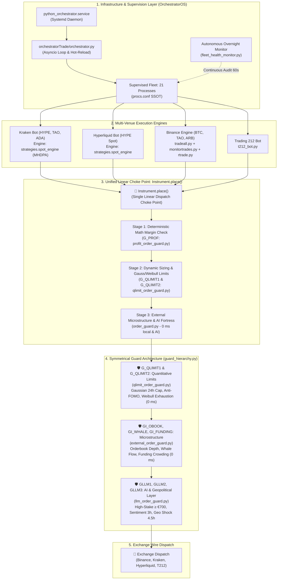
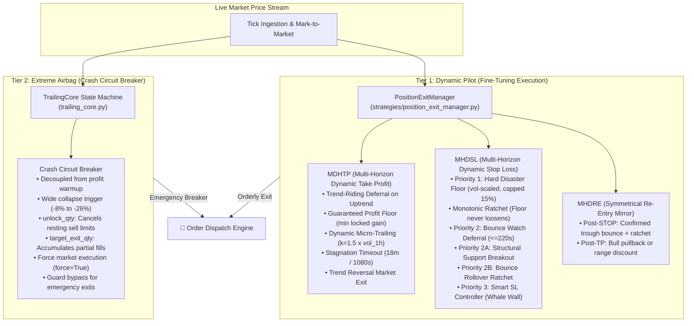

# mptrade — Multi-Venue Autonomous Trading System

The repository contains the production live trading, multi-pillar risk supervision, and monitoring fleet for Binance, Kraken, Hyperliquid, and Trading 212, alongside a dedicated offline replay, parameter sweep, and walk-forward validation cluster.

> [!WARNING]
> The code manages real funds across connected venues. Do not manually start live processes outside the orchestrator or run conflicting fleets with identical credentials. Always use `procs.conf` and the verified operational runbooks.

---

## 1. System Architecture Overview



---

## 2. Core Architectural Tenets

1. **Single Source of Truth (SSOT):** Canonical definition and resolution for all domain state, configuration, and rules.
   - Process manifest: [`procs.conf`](file:///home/predut/mptrade/procs.conf)
   - Risk guards & thresholds: [`order_guard.conf`](file:///home/predut/mptrade/order_guard.conf)
   - Strategy configurations: [`kraken/config.env`](file:///home/predut/mptrade/kraken/config.env) & [`hyperliquid/config.env`](file:///home/predut/mptrade/hyperliquid/config.env)
2. **Unification & Compaction (Single Linear Choke Points):** Fragmented execution and guard logic is consolidated into single linear choke points. All venues route order submissions strictly through [`Instrument.place()`](file:///home/predut/mptrade/instrument.py) and [`order_guard.profit_guard()`](file:///home/predut/mptrade/order_guard.py).
3. **Fail-Closed Safety:** If local market cache, account balance telemetry, or WebSocket connectivity drops, submissions are deferred or refused (`account_cache_not_fresh`, `stale_cache_guard`) to protect capital.
4. **Separation of Concerns (SoC):** Mathematical pricing, risk guard vetting, exchange transport, and telemetry collection reside in decoupled modules.

---

## 3. Fleet Orchestration & Supervision

The live system is orchestrated by [`python_orchestrator.service`](file:///home/predut/mptrade/orchestratorTrade/orchestrator.py), which runs `orchestrator.py` via systemd:

* **Single Process Manifest ([`procs.conf`](file:///home/predut/mptrade/procs.conf)):** Defines all 21 supervised processes, working directories, execution commands, heartbeat log locations, and maximum staleness thresholds (`hb_stale_s`).
* **Hot-Reload Loop:** Watches `config.env`, `procs.conf`, `instruments.conf`, and `order_guard.conf` every 10 seconds. When configurations change, affected bots are automatically and gracefully restarted.
* **Zombie / Hang Detection:** Monitors heartbeat file modification times. If a process is alive but its heartbeat exceeds `hb_stale_s`, the orchestrator terminates the hung process (`SIGTERM` -> `SIGKILL`) and restarts it cleanly, notifying via `ntfy`.
* **Autonomous Overnight Monitor ([`fleet_health_monitor.py`](file:///home/predut/mptrade/orchestratorOS/livecheck/fleet_health_monitor.py)):** Audits fleet running state, heartbeat freshness, telemetry sensor scores, host resource utilization, and DEV backtest progress into `cachedb/fleet_health_status.json`.

---

## 4. Unified Execution Pipeline: `Instrument.place()`

All order generation flows pass through the 3-stage pipeline in [`instrument.py`](file:///home/predut/mptrade/instrument.py):

* **Stage 1 (Deterministic Mathematical Check):** Validates profit margin against the historical fill reference (14-day default window). Protects sells from executing below basis and prevents buying above recent sales.
* **Stage 2 (Dynamic Quantity Sizing & Regime Weights):**
  * Sizing is weighted by market trend confidence using a Gaussian distribution.
  * In non-trending sideways regimes, sizing downscales to `default_chop_weight = 0.03` (3% exploration size).
  * Assets without long-term history borrow Bitcoin's market beta via `kraken_weight_proxy = BTCUSDC`.
* **Stage 3 (Pre-Trade Intelligence Risk Fortress):** Passes finalized order parameters to [`order_guard.py`](file:///home/predut/mptrade/order_guard.py).
* **Hierarchical Gate Bypass Architecture (`bypass_guards`):** Allows selective, safe bypassing of specific guards (e.g. for re-buys following a trailing stop trigger) with 3-tier precedence:
  1. Explicit call argument: `inst.place(..., bypass_guards={"math_reference", "cooldown"})`
  2. Instrument-level parameters: `inst.params["bypass_guards"]`
  3. Venue/global configuration in [`order_guard.conf`](file:///home/predut/mptrade/order_guard.conf): `binance_bypass_guards`, `kraken_bypass_guards`, `default_bypass_guards`

---

## 5. Symmetrical Guard Hierarchy (`guard_hierarchy.py` & `order_guard.py`)

| Category & Codes | Coordinator Module | Latency | LLM Status | Enforced Policies & Safeguards |
| :--- | :--- | :--- | :--- | :--- |
| **`GO` (`GO1`) & `GT` (`GT_S`, `GT_M`, `GT_L`)** | [`order_guard.py`](file:///home/predut/mptrade/order_guard.py) / [`market_regime.py`](file:///home/predut/mptrade/market_regime.py) | **0 ms** (in-memory) | 🚫 **NO LLM** | **`GO1` (`daily_limit`):** Blocks orders when rolling 24h trade count limit is reached.<br>**`GT_S` / `GT_M` / `GT_L`:** Multi-horizon Kalman & linear regression trend regime guards (5m short, 1h medium, 24h long). |
| **`G_PROF`** | [`profit_order_guard.py`](file:///home/predut/mptrade/profit_order_guard.py) | **0 ms** (in-memory) | 🚫 **NO LLM** | **Mathematical Profit Margin (`math_profit`):** Protects sells from executing below historical buy anchor and prevents buys above active-cycle sell anchor. |
| **`G_QLIMIT` (`G_QLIMIT1`, `G_QLIMIT2`)** | [`qlimit_order_guard.py`](file:///home/predut/mptrade/qlimit_order_guard.py) | **0 ms** (in-memory) | 🚫 **NO LLM** | **`G_QLIMIT1` (`quantity_policy`):** 24h Gaussian persistence weight curve ($0 \dots 1.4 \times T$) & dynamic sizing.<br>**`G_QLIMIT2` (`internal_quant_limit`):** Anti-FOMO Parabolic Surge/Dump (2h window) + Asymmetric Weibull Survival Exhaustion ($S(t) = \exp(-(t/\lambda)^k)$ beyond Gaussian horizon $1.4 \times T$). |
| **`GI` (`GI_OBOOK`, `GI_WHALE`, `GI_FUNDING`)** | [`external_order_guard.py`](file:///home/predut/mptrade/external_order_guard.py) | **0 ms** (local cache) | 🚫 **NO LLM** | **`GI_OBOOK` (`orderbook_wall`):** Vetoes/defers orders facing overhead ask/bid walls > \$1,000,000 or severe book imbalance.<br>**`GI_WHALE` (`whale_flow`):** Evaluates whale OI divergence & taker flow supremacy; blocks liquidation cascades or downscales size.<br>**`GI_FUNDING` (`funding_crowding`):** Downscales/defers orders when perpetual funding rate is overcrowded. |
| **`GLLM` (`GLLM1`, `GLLM2`, `GLLM3`)** | [`llm_order_guard.py`](file:///home/predut/mptrade/llm_order_guard.py) | **`GLLM1`: 10–15 s**<br>**`GLLM2/3`: < 1 ms** (cache) | 🤖 **ACTIVE & ASYNC LLM** | **`GLLM1` (`llm_high_stake`):** Pre-trade Gemini LLM vetting for large BUY/SELL orders ($\ge 700\text{ EUR/USD}$) + post-stop re-entry bounce check.<br>**`GLLM2` (`llm_sentiment`):** 3h background LLM synthesis of Fear & Greed + Market Breadth (`sentiment_advisor.py`).<br>**`GLLM3` (`llm_geopolitical`):** 4.5h background + event-driven LLM geopolitical shock shield (`geopolitical_guard.py`). |

---

## 6. Multi-Horizon Dynamic Profit Architecture (MHDPA) & Position Exit Manager

The core trading engines deployed across Kraken, Hyperliquid, Binance, and Trading 212 incorporate:

1. **Initial Discount Entry (`STRAT_ENTRY_DISCOUNT_PCT = 0.8%`):** Enters positions via limit orders placed below market price.
2. **Progressive DCA Spacing (`STRAT_DCA_SPACING_GROWTH_PCT = 0.25pp`):** Widens spacing between consecutive DCA tiers, conserving dry powder for deep market bottoms.
3. **Downtrend Brake (`STRAT_DCA_TREND_BRAKE = true`):** Pauses DCA additions during sharp steep drops until velocity stabilizes.
4. **Hybrid Re-Entry (`STRAT_REENTRY_HYBRID_ENABLED = true`):** Dynamically re-enters pullbacks in confirmed bull regimes while demanding a 2.0% defensive discount and trough bounce during choppy/bear regimes.
5. **Adaptive Volatility Trailing Stop (`04_adaptive_trail_k15`):**
   $$\text{Trail Distance} = \text{clamp}(k \times \text{vol\_1h},\; 1.5\%,\; 6.0\%), \quad k = 1.5$$
   Promoted from the 30-candidate overnight sweep: achieved **+96.05% compounding net return** and **4.50 Calmar ratio** across 628 days (31 Walk-Forward folds).
6. **Micro-Trend Kalman Filter (60s Sampling):** Calibrated on 329 days of real ticks to eliminate high-frequency noise and overtrading (which caused \$10,000+ drag at 20s sampling).
7. **Centralized `PositionExitManager` (MHDSL Stop-Loss & MDHTP Take-Profit Mirror):**
   * **Take-Profit (MDHTP):**
     * *Priority 0 (Hard TP Spike):* Fast partial liquidation on violent upside spikes.
     * *Priority 1 (Trend Riding):* Defers exit at base target to ride confirmed uptrends, tracking peak price.
     * *Priority 2 (Guaranteed Profit Floor):* Non-negotiable circuit breaker protecting captured gains.
     * *Priority 3 (Dynamic Micro-Trailing):* Volatility-scaled pullback exit ($k=1.5$, clamp $1.5\% - 6.0\%$).
     * *Priority 4 (Stagnation Timeout):* 18-minute (1080s) exit if price consolidates without fresh highs.
     * *Priority 5 (Trend Reversal):* Liquidates position when the trend turns downward.
   * **Stop-Loss (MHDSL):**
     * *Priority 1 (Hard Disaster Floor):* Volatility-scaled circuit breaker ($\max(\text{loss} \times 0.30, \text{vol}_{1h} \times 0.85, 0.8\%)$) capped at `sl_disaster_buffer_max_pct = 15%`. Unconditional execution bypassing trend deferrals.
     * *Monotonic Ratchet:* Armed disaster floor ratchets monotonically; once active, subsequent volatility surges cannot loosen or retreat the protective stop floor.
     * *Priority 2 (Bounce Protection):* Deferral up to 220s during uptrends with dynamic ratchet and structural support break detection.
     * *Priority 3 (Smart Stop-Loss):* Microstructure orderbook absorption veto against predatory wick stops.
   * **Symmetrical Re-Entry Mirror (MHDRE):**
     * Post-STOP requires confirmed recovery bounce above trough with anti-rollover ratchet and bear trend gate.
     * Post-TP enforces bull trend pullback or sideways discount drop before allowing repurchases.
   * **Single Source of Truth (SSOT) Volatility Resolution:** Unified in `intelligence.internal.state.volatility`, guaranteeing seamless decimal ratio conversion ($1\% \to 0.01$) across all callers.
   * **Mathematical Isolation:** SL and TP engines operate on separate state dictionaries, ensuring Stop-Loss enhancements cannot corrupt, preempt, or degrade Take-Profit executions.

---

## 7. Two-Tier Defense Architecture & Fleet Protection Matrix

To guarantee capital preservation across all trading venues, MPTrade enforces a hardened **Two-Tier Exit Defense Framework** detailed in [`docs/FLEET_PROTECTION_MATRIX.md`](file:///home/predut/mptrade/docs/FLEET_PROTECTION_MATRIX.md):



### Fleet-Wide Protection Matrix

| Venue | Symbol / Asset | Role | Tier 1: Dynamic Protection (MHDSL / MDHTP / DCA) | Tier 2: Extreme Airbag (Crash Circuit Breaker) | Operational Status |
| :--- | :--- | :--- | :--- | :--- | :--- |
| **Binance** | `BTCUSDC` | Spot Swing / Grid | **MHDSL:** Loss `2.925%`, bounce watch, ratchet, `hard_tp = 21.0%` (0.5 tranche, 6h cooldown).<br>**MDHTP:** Active in `monitortrades.py`. | **Trailing Stop:** `16%` from peak.<br>**Decoupled from warmup.** `unlock_qty` active. | **ACTIVE.** Dual-layer protected (Backtest winner damped to 21%). |
| **Binance** | `TAOUSDC` | Spot Swing / Grid | **MHDSL:** Loss `5.25%`, bounce watch, ratchet, `hard_tp = 17%` (0.5 tranche).<br>**MDHTP:** Active in `monitortrades.py`. | **Trailing Stop:** `22%` from peak.<br>**Decoupled from warmup.** `unlock_qty` active. | **ACTIVE.** High-beta AI asset. |
| **Binance** | `ARBUSDC` | Spot Swing / Grid | **MHDSL:** Loss `4.375%`, gain `9.0%`, bounce watch, ratchet, `hard_tp = 17%`.<br>**MDHTP:** Active.<br>**Chop Protection:** `kalman_mode = strict` (eliminates noise trades). | **Trailing Stop:** `26%` from peak.<br>**Decoupled from warmup.** MA-100 rebuy. | **ACTIVE (`role.mt = yes`).** Activated in `instruments.conf` (Backtest winner applied). |
| **Kraken** | `HYPEUSD` | DCA Spot Engine | **MHDSL:** Active via `spot_engine.py` + `PositionExitManager`.<br>**MDHTP:** Enabled (`STRAT_TP_MDHTP_ENABLED=true`), TP `6.0%`, adaptive trail ($k=1.8$, max `7.5%`), floor `1%`.<br>**DCA Brake:** `STRAT_DCA_TREND_BRAKE=true`, drop `1.35%` (+0.25pp spacing growth).<br>**Re-entry:** Drop `2.5%`. | **Multi-Asset Trailing:** `18%` in `kraken/trailing_stop.py`.<br>**Decoupled from warmup.** `unlock_qty` active. | **ACTIVE.** 628-day compounding winner applied (+70.14% net, Calmar 3.37). |
| **Kraken** | `TAOUSD` | DCA Spot Engine | **MHDSL:** Active via `PositionExitManager`.<br>**MDHTP:** Enabled (`STRAT_TP_MDHTP_ENABLED=true`).<br>**DCA Brake:** Active with spacing growth `+0.25pp`. | **Multi-Asset Trailing:** `22%` in `kraken/trailing_stop.py`.<br>**Decoupled from warmup.** `unlock_qty` active. | **ACTIVE.** Multi-asset coverage. |
| **Kraken** | `ADAUSD` | DCA Spot Engine | **MHDSL:** Active via `PositionExitManager`.<br>**MDHTP:** Enabled (`STRAT_TP_MDHTP_ENABLED=true`).<br>**DCA Brake:** Active. | **Multi-Asset Trailing:** `25%` in `kraken/trailing_stop.py`.<br>**Decoupled from warmup.** `unlock_qty` active. | **ACTIVE.** Multi-asset coverage. |
| **Hyperliquid** | `HYPEUSDC` (Spot/Perp) | DCA Long-Term | **MHDSL:** `STRAT_STOP_LOSS_PCT=25%`, `hard_disaster_floor_breached` cuts position immediately.<br>**MDHTP:** Enabled (`STRAT_TP_MDHTP_ENABLED=true`), TP `6.0%` (walk-forward winner), adaptive trail ($k=1.5$).<br>**DCA Brake:** Active, spacing growth `0.25pp`. | **Circuit Breaker:** `hard_disaster_floor_breached` (urgent market exit via `_request_market_exit`). | **ACTIVE.** Downtrend brake & disaster stop. |
| **Trading 212** | `SPCX_US_EQ` | Portfolio Stock | **MHDSL:** Active (`STRAT_SL_MHDSL_ENABLED=true`), disaster floor 30%, rebuy 1.2% bounce.<br>**MDHTP:** Active, dynamic 5-rung bell-curve ladder (`5-25:5:bell`). | **Trailing Stop:** `8%` from peak.<br>**Decoupled from warmup.** (+5% warm-up bypassed on extreme drops). | **ACTIVE.** `tp_pending_exit` persistence. |
| **Trading 212** | `NVDA_US_EQ` | Portfolio Stock | **MHDSL:** Activated (`STRAT_SL_MHDSL_ENABLED=true`), disaster floor 30%, rebuy 1.2% bounce.<br>**MDHTP:** Activated (`STRAT_TP_MDHTP_ENABLED=true`).<br>**DCA Drop:** `1.5%` (walk-forward winner, reduced drawdown). | **Trailing Stop:** `8%` from peak, decoupled from warmup (+5%). | **ACTIVE.** Modernized to fleet standard. |
| **Trading 212** | `RGNT_US_EQ` | High-Vol Biotech | **MHDSL:** Activated (`STRAT_SL_MHDSL_ENABLED=true`), disaster floor `50%` (DCA at -40%).<br>**MDHTP:** Activated (`STRAT_TP_MDHTP_ENABLED=true`), pump ride over +35%.<br>**Rebuy:** Active on 3.0% recovery bounce. | **Trailing Crash Breaker:** `20%` from peak with `20%` warmup (avoids intraday noise of +/-15%). | **ACTIVE.** Calibrated for extreme biotech volatility. |

### Fleet-Wide Hardened Invariants & Safety Guarantees
1. **DCA Buy Suppression on Bounce Watch (`sl_bounce_state`):** When a position breaches stop-loss territory and enters bounce deferral, DCA additions are strictly suppressed to avoid doubling down into an unresolved market drop.
2. **Automatic Balance Unlocking (`unlock_qty`):** Prevents emergency liquidations from failing due to balances locked in passive resting TP limit orders. Adapters cancel conflicting sell limits before executing market stops.
3. **Partial Exit Tracking (`target_exit_qty`):** `TrailingCore` accumulates sold quantities and cost basis across partial fills, preserving peak protection and armed rebuy sizing until the entire target position is cleared.
4. **Composite Client Order Identity (`client_order_id`):** Orders embed strategy and bot lineage (`inst.client_order_id`), allowing `monitororder` to safely reprice and track orders without identity collisions.
5. **Exit Intent Persistence (`pending_exit` / `tp_pending_exit`):** If an exit order is rejected by an exchange due to network blips or rate limits, the exit state does not revert to HOLD; it persists and re-executes until fill confirmation.
6. **Emergency Floor Under Cost Basis:** If market price collapses below average cost basis during an active profit ride, an immediate emergency floor liquidation triggers, protecting original principal.
7. **Monitortrades STOP Rollback Protection:** If stop-loss placement fails or is rejected, active TP orders are restored safely without race conditions.

---

## 8. Autonomous AI Supervisor & Intent Gateway

* **Nightly AI Supervisor ([`autonomous_ai_reconciler.py`](file:///home/predut/mptrade/orchestratorOS/supervisor/autonomous_ai_reconciler.py)):** Audits system logs, diagnoses anomalies, refreshes balance snapshots (`SYNC_POSITION`), and evaluates macro breadth in `enforce` mode.
* **Autonomous Intent Gateway ([`autonomous_intent_gateway.py`](file:///home/predut/mptrade/orchestratorTrade/autonomous_intent_gateway.py)):** Evaluates independent algorithmic trade generation, requiring high conviction ($\ge 0.85$), capped at €500 per order, and passing all 4 Risk Pillars.

---

## 9. Supervised Fleet Process Inventory (21 Processes)

```text
PROCS.CONF
├── Bots (role=bot)
│   ├── HL-bot                    (hyperliquid/hl_bot.py)
│   ├── Kraken-cache              (kraken/kraken_cachemanager.py)
│   ├── Kraken-HYPE               (kraken/kraken_bot.py)
│   ├── Kraken-TAO                (kraken/kraken_bot.py --pair TAOUSD)
│   ├── Kraken-ADA                (kraken/kraken_bot.py --pair ADAUSD)
│   ├── xStock-watch              (kraken/kraken_xstock_watch.py)
│   ├── T212-bot                  (212trading/t212_bot.py)
│   ├── Kraken-trailing           (kraken/trailing_stop.py)
│   └── Binance-trailing          (binance_api/trailing_stop.py)
└── Fleet Daemons (role=fleet)
    ├── cacheManager              (cacheManager.py)
    ├── assetguardian             (assetguardian.py)
    ├── priceAnalysis             (priceAnalysis.py)
    ├── tradeall                  (tradeall.py)
    ├── tradeall_price_archiver   (tradeall_price_archiver.py)
    ├── monitortrades             (monitortrades.py)
    ├── monitororder              (monitororder.py)
    ├── rtrade                    (rtrade.py)
    ├── price_watcher            (market_monitor/price_watcher.py)
    ├── order_retry               (order_retry_worker.py)
    ├── globaltelemetry_collector (globaltelemetry_collector.py)
    └── macro_analyzer            (macro_analyzer.py)
```

---

## 10. Dedicated DEV Backtest & Research Cluster (`192.168.0.138:32238`)

Heavy multi-hour parameter sweeps and walk-forward evaluations are offloaded to the dedicated DEV host `backtest`:
* **Master Suite Execution Status:** Completed 35h 54m autonomous run across all 10 stages (`OVERNIGHT_MASTER_REPORT.md`):
  * *Step 0A/0B:* 4-Pillars Intelligence & Chop Weight benchmarks (407 days) — **PASSED**
  * *Step 1:* Kraken HYPE 240m Walk-Forward (628 days, 31 folds) — **PASSED**
  * *Step 2:* Trading 212 Walk-Forward (NVDA, RGNT, SPCX) — **PASSED**
  * *Step 3:* Kraken Adaptive Multipliers (K_REENTRY & K_DCA) — **PASSED**
  * *Step 4:* 30-Candidate Multi-Factor Strategy Sweep — **PASSED**
  * *Step 5:* TradeAll Trigger Gate, Quality Signal, RSI/Bollinger, and Dual Timeframe experiments — **PASSED**
  * *Step 6:* TradeAll Adaptive Thresholds & Kalman Sampling Lag (20s/60s/90s/150s) sweeps — **PASSED**
  * *Step 7:* Monitortrades 392-day tick replay on Binance history — **PASSED**
  * *Step 8:* Automated proposals generation pushed to branch `backtest-proposals` — **PUBLISHED**
  * *Step 9:* Kraken continuous multi-asset grid — **COMPLETED**
* **Sync Pipeline ([`sync_cache_to.sh`](file:///home/predut/mptrade/offline/runners/sync_cache_to.sh)):** Syncs upstream code via `git pull --ff-only` and mirrors live `cachedb/` tick archives via `rsync` to `dev` (`sync_cache_to.sh dev`) and `wsl` (`sync_cache_to.sh wsl`).

---

## 11. Quick Operations Runbook

| Objective | Command |
| :--- | :--- |
| **Fleet Healthcheck (Single Shot)** | `./myenv/bin/python orchestratorOS/livecheck/fleet_health_monitor.py --once` |
| **Fleet Status / Logs** | `systemctl status python_orchestrator.service` / `journalctl -u python_orchestrator.service -f` |
| **Restart Live Fleet** | `sudo systemctl restart python_orchestrator.service` *(Orchestrator also auto-reloads on config edit)* |
| **Sync Code & Data to DEV** | `bash offline/runners/sync_cache_to.sh dev` |
| **Launch Overnight Master Suite on DEV** | `ssh -p 32238 predut@192.168.0.138 "nohup bash ~/mptrade/offline/runners/run_overnight_master_suite.sh > ~/mptrade/logs/overnight_runs/master_suite_current.log 2>&1 &"` |
| **Tail DEV Master Suite Log** | `ssh -p 32238 predut@192.168.0.138 "tail -f ~/mptrade/logs/overnight_runs/master_suite_current.log"` |
| **Run Core Test Regressions** | `./myenv/bin/python -m pytest tests/test_instrument_guards.py tests/test_order_guard_pillars.py tests/test_spot_explicit_configuration.py` |

---

## 12. Repository Navigation Map

| Directory | Architectural Role |
| :--- | :--- |
| [`orchestratorTrade/`](file:///home/predut/mptrade/orchestratorTrade/) | Asyncio fleet supervisor, hot-reloader, and autonomous intent gateway |
| [`orchestratorOS/`](file:///home/predut/mptrade/orchestratorOS/) | Autonomous overnight monitor, system watchdogs, AI nightly reconciler |
| [`providers/`](file:///home/predut/mptrade/providers/) | Exchange transport adapters (Binance, Kraken, Hyperliquid, Trading 212) |
| [`strategies/`](file:///home/predut/mptrade/strategies/) | Shared MHDPA spot strategy engine (`spot_engine.py`) and state persistence |
| [`intelligence/`](file:///home/predut/mptrade/intelligence/) | Microstructure collectors, orderbook depth, whale flow, sentiment, geopolitics |
| [`offline/`](file:///home/predut/mptrade/offline/) | Master suite runners, walk-forward pipelines, continuous grid scripts |
| [`cachedb/`](file:///home/predut/mptrade/cachedb/) | High-speed price tick caches, orderbook snapshots, state files |
| [`tests/`](file:///home/predut/mptrade/tests/) | Hermetic unit, integration, and regression test suites |
| [`docs/`](file:///home/predut/mptrade/docs/) | Detailed sub-system documentation and design specifications |
