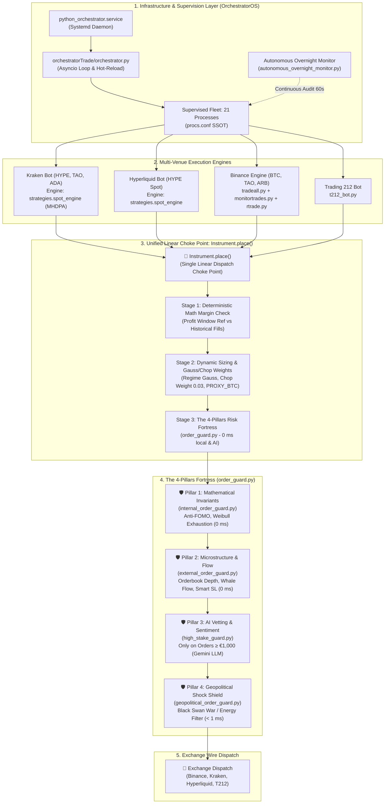

# mptrade — Multi-Venue Autonomous Trading System

The repository contains the production live trading, multi-pillar risk supervision, and monitoring fleet for Binance, Kraken, Hyperliquid, and Trading 212, alongside a dedicated offline replay, parameter sweep, and walk-forward validation cluster.

> [!WARNING]
> The code manages real funds across connected venues. Do not manually start live processes outside the orchestrator or run conflicting fleets with identical credentials. Always use `procs.conf` and the verified operational runbooks.

---

## 1. System Architecture Overview



---

## 2. Core Architectural Tenets

1. **Single Source of Truth (SSOT):** Canonical definition and resolution for all domain state, configuration, and rules.
   - Process manifest: [`procs.conf`](file:///home/predut/mptrade/procs.conf)
   - Risk guards & thresholds: [`order_guard.conf`](file:///home/predut/mptrade/order_guard.conf)
   - Strategy configurations: [`kraken/config.env`](file:///home/predut/mptrade/kraken/config.env) & [`hyperliquid/config.env`](file:///home/predut/mptrade/hyperliquid/config.env)
2. **Unification & Compaction (Single Linear Choke Points):** Fragmented execution and guard logic is consolidated into single linear choke points. All venues route order submissions strictly through [`Instrument.place()`](file:///home/predut/mptrade/instrument.py) and [`order_guard.profit_guard()`](file:///home/predut/mptrade/order_guard.py).
3. **Fail-Closed Safety:** If local market cache, account balance telemetry, or WebSocket connectivity drops, submissions are deferred or refused (`account_cache_not_fresh`, `stale_cache_guard`) to protect capital.
4. **Separation of Concerns (SoC):** Mathematical pricing, risk guard vetting, exchange transport, and telemetry collection reside in decoupled modules.

---

## 3. Fleet Orchestration & Supervision

The live system is orchestrated by [`python_orchestrator.service`](file:///home/predut/mptrade/orchestratorTrade/orchestrator.py), which runs `orchestrator.py` via systemd:

* **Single Process Manifest ([`procs.conf`](file:///home/predut/mptrade/procs.conf)):** Defines all 21 supervised processes, working directories, execution commands, heartbeat log locations, and maximum staleness thresholds (`hb_stale_s`).
* **Hot-Reload Loop:** Watches `config.env`, `procs.conf`, `instruments.conf`, and `order_guard.conf` every 10 seconds. When configurations change, affected bots are automatically and gracefully restarted.
* **Zombie / Hang Detection:** Monitors heartbeat file modification times. If a process is alive but its heartbeat exceeds `hb_stale_s`, the orchestrator terminates the hung process (`SIGTERM` -> `SIGKILL`) and restarts it cleanly, notifying via `ntfy`.
* **Autonomous Overnight Monitor ([`autonomous_overnight_monitor.py`](file:///home/predut/mptrade/orchestratorOS/livecheck/autonomous_overnight_monitor.py)):** Audits fleet running state, heartbeat freshness, telemetry sensor scores, host resource utilization, and DEV backtest progress into `cachedb/overnight_monitor_status.json`.

---

## 4. Unified Execution Pipeline: `Instrument.place()`

All order generation flows pass through the 3-stage pipeline in [`instrument.py`](file:///home/predut/mptrade/instrument.py):

* **Stage 1 (Deterministic Mathematical Check):** Validates profit margin against the historical fill reference (14-day default window). Protects sells from executing below basis and prevents buying above recent sales.
* **Stage 2 (Dynamic Quantity Sizing & Regime Weights):**
  * Sizing is weighted by market trend confidence using a Gaussian distribution.
  * In non-trending sideways regimes, sizing downscales to `default_chop_weight = 0.03` (3% exploration size).
  * Assets without long-term history borrow Bitcoin's market beta via `kraken_weight_proxy = BTCUSDC`.
* **Stage 3 (Pre-Trade Intelligence Risk Fortress):** Passes finalized order parameters to [`order_guard.py`](file:///home/predut/mptrade/order_guard.py).
* **Hierarchical Gate Bypass Architecture (`bypass_guards`):** Allows selective, safe bypassing of specific guards (e.g. for re-buys following a trailing stop trigger) with 3-tier precedence:
  1. Explicit call argument: `inst.place(..., bypass_guards={"math_reference", "cooldown"})`
  2. Instrument-level parameters: `inst.params["bypass_guards"]`
  3. Venue/global configuration in [`order_guard.conf`](file:///home/predut/mptrade/order_guard.conf): `binance_bypass_guards`, `kraken_bypass_guards`, `default_bypass_guards`

---

## 5. The 4-Pillars Risk Fortress (`order_guard.py`)

| Pillar | Module | Latency | LLM Status | Enforced Policies & Safeguards |
| :--- | :--- | :--- | :--- | :--- |
| **Pillar 1** | [`internal_order_guard.py`](file:///home/predut/mptrade/internal_order_guard.py) | **0 ms** (in-memory) | 🚫 **NO LLM** | **Anti-FOMO Parabolic Surge:** Vetoes buys during parabolic spikes (>18% gain without 3.5% pullback).<br>**Weibull Exhaustion:** Statistical hazard ratio scales down aged trends by 75% (`scale=0.25`).<br>**Daily Loss Budget:** Blocks orders when rolling 24h drawdown limit is reached. |
| **Pillar 2** | [`external_order_guard.py`](file:///home/predut/mptrade/external_order_guard.py) | **0 ms** (local cache) | 🚫 **NO LLM** | **Orderbook Depth & Walls:** Vetoes or defers orders facing overhead ask walls > \$1,000,000 or bid depth < 25%.<br>**Funding Crowding:** Downscales order by 50% if perpetual funding rate exceeds 0.05% (squeeze risk).<br>**Whale Flow & Cascades:** Blocks entries during net whale short cascades (preventing falling knives).<br>**Smart Stop Loss:** Pauses tight stop-loss orders ($\le 6\%$) for 120s if whale absorption indicates a predatory wick hunt. |
| **Pillar 3** | [`high_stake_guard.py`](file:///home/predut/mptrade/intelligence/sentiment/guards/high_stake_guard.py) | **10–15 s** (event-driven) | 🤖 **ACTIVE LLM** | Pre-trade qualitative risk vetting via Gemini LLM **strictly for large orders ($\ge 1,000\text{ EUR}$)**. Evaluates macro sentiment, liquidity conditions, and market breadth. |
| **Pillar 4** | [`geopolitical_order_guard.py`](file:///home/predut/mptrade/geopolitical_order_guard.py) | **< 1 ms** (local cache) | 🤖 **BACKGROUND LLM** | Evaluates international news, military conflicts, and energy crises asynchronously every 4.5 hours. Enforces immediate `HARD_VETO` during `CRITICAL_SHOCK` events. |

---

## 6. Multi-Horizon Dynamic Profit Architecture (MHDPA) & Position Exit Manager

The core trading engines deployed across Kraken, Hyperliquid, Binance, and Trading 212 incorporate:

1. **Initial Discount Entry (`STRAT_ENTRY_DISCOUNT_PCT = 0.8%`):** Enters positions via limit orders placed below market price.
2. **Progressive DCA Spacing (`STRAT_DCA_SPACING_GROWTH_PCT = 0.25pp`):** Widens spacing between consecutive DCA tiers, conserving dry powder for deep market bottoms.
3. **Downtrend Brake (`STRAT_DCA_TREND_BRAKE = true`):** Pauses DCA additions during sharp steep drops until velocity stabilizes.
4. **Hybrid Re-Entry (`STRAT_REENTRY_HYBRID_ENABLED = true`):** Dynamically re-enters pullbacks in confirmed bull regimes while demanding a 2.0% defensive discount and trough bounce during choppy/bear regimes.
5. **Adaptive Volatility Trailing Stop (`04_adaptive_trail_k15`):**
   $$\text{Trail Distance} = \text{clamp}(k \times \text{vol\_1h},\; 1.5\%,\; 6.0\%), \quad k = 1.5$$
   Promoted from the 30-candidate overnight sweep: achieved **+96.05% compounding net return** and **4.50 Calmar ratio** across 628 days (31 Walk-Forward folds).
6. **Micro-Trend Kalman Filter (60s Sampling):** Calibrated on 329 days of real ticks to eliminate high-frequency noise and overtrading (which caused \$10,000+ drag at 20s sampling).
7. **Centralized `PositionExitManager` (MHDSL Stop-Loss & MDHTP Take-Profit Mirror):**
   * **Take-Profit (MDHTP):**
     * *Priority 0 (Hard TP Spike):* Fast partial liquidation on violent upside spikes.
     * *Priority 1 (Trend Riding):* Defers exit at base target to ride confirmed uptrends, tracking peak price.
     * *Priority 2 (Guaranteed Profit Floor):* Non-negotiable circuit breaker protecting captured gains.
     * *Priority 3 (Dynamic Micro-Trailing):* Volatility-scaled pullback exit ($k=1.5$, clamp $1.5\% - 6.0\%$).
     * *Priority 4 (Stagnation Timeout):* 18-minute (1080s) exit if price consolidates without fresh highs.
     * *Priority 5 (Trend Reversal):* Liquidates position when the trend turns downward.
   * **Stop-Loss (MHDSL):**
     * *Priority 1 (Hard Disaster Floor):* Volatility-scaled circuit breaker ($\max(\text{loss} \times 0.30, \text{vol}_{1h} \times 0.85, 0.8\%)$) with unconditional execution, bypassing trend deferrals.
     * *Priority 2 (Bounce Protection):* Deferral up to 220s during uptrends with dynamic ratchet and structural support break detection.
     * *Priority 3 (Smart Stop-Loss):* Microstructure orderbook absorption veto against predatory wick stops.
   * **Symmetrical Re-Entry Mirror (MHDRE):**
     * Post-STOP requires confirmed recovery bounce above trough with anti-rollover ratchet and bear trend gate.
     * Post-TP enforces bull trend pullback or sideways discount drop before allowing repurchases.
   * **Mathematical Isolation:** SL and TP engines operate on separate state dictionaries, ensuring Stop-Loss enhancements cannot corrupt, preempt, or degrade Take-Profit executions.

---

## 7. Autonomous AI Supervisor & Intent Gateway

* **Nightly AI Supervisor ([`autonomous_ai_reconciler.py`](file:///home/predut/mptrade/orchestratorOS/supervisor/autonomous_ai_reconciler.py)):** Audits system logs, diagnoses anomalies, refreshes balance snapshots (`SYNC_POSITION`), and evaluates macro breadth in `enforce` mode.
* **Autonomous Intent Gateway ([`autonomous_intent_gateway.py`](file:///home/predut/mptrade/orchestratorTrade/autonomous_intent_gateway.py)):** Evaluates independent algorithmic trade generation, requiring high conviction ($\ge 0.85$), capped at €500 per order, and passing all 4 Risk Pillars.

---

## 8. Supervised Fleet Process Inventory (21 Processes)

```text
PROCS.CONF
├── Bots (role=bot)
│   ├── HL-bot                    (hyperliquid/hl_bot.py)
│   ├── Kraken-cache              (kraken/kraken_cachemanager.py)
│   ├── Kraken-HYPE               (kraken/kraken_bot.py)
│   ├── Kraken-TAO                (kraken/kraken_bot.py --pair TAOUSD)
│   ├── Kraken-ADA                (kraken/kraken_bot.py --pair ADAUSD)
│   ├── xStock-watch              (kraken/kraken_xstock_watch.py)
│   ├── T212-bot                  (212trading/t212_bot.py)
│   ├── Kraken-trailing           (kraken/trailing_stop.py)
│   └── Binance-trailing          (binance_api/trailing_stop.py)
└── Fleet Daemons (role=fleet)
    ├── cacheManager              (cacheManager.py)
    ├── assetguardian             (assetguardian.py)
    ├── priceAnalysis             (priceAnalysis.py)
    ├── tradeall                  (tradeall.py)
    ├── tradeall_price_archiver   (tradeall_price_archiver.py)
    ├── monitortrades             (monitortrades.py)
    ├── monitororder              (monitororder.py)
    ├── rtrade                    (rtrade.py)
    ├── price_notifier            (market_monitor/price_notifier.py)
    ├── order_retry               (order_retry_worker.py)
    ├── globaltelemetry_collector (globaltelemetry_collector.py)
    └── macro_analyzer            (macro_analyzer.py)
```

---

## 9. Dedicated DEV Backtest & Research Cluster (`192.168.0.138:32238`)

Heavy multi-hour parameter sweeps and walk-forward evaluations are offloaded to the dedicated DEV host `backtest`:
* **Master Suite Runner ([`run_overnight_master_suite.sh`](file:///home/predut/mptrade/offline/runners/run_overnight_master_suite.sh)):** Automated multi-stage sweep running Steps 0–9 (~31h duration):
  * *Step 0A/0B:* 4-Pillars Intelligence & Chop Weight benchmarks (407 days).
  * *Step 1:* Kraken HYPE 240m Walk-Forward (628 days, 31 folds).
  * *Step 2:* Trading 212 Walk-Forward (NVDA, RGNT, SPCX).
  * *Step 3:* Kraken Adaptive Multipliers (K_REENTRY & K_DCA).
  * *Step 4:* 30-Candidate Multi-Factor Strategy Sweep.
  * *Step 5:* TradeAll Trigger Gate, Quality Signal, RSI/Bollinger, and Dual Timeframe experiments.
  * *Step 6:* TradeAll Adaptive Thresholds & Kalman Sampling Lag sweeps.
  * *Step 7:* Monitortrades 392-day tick replay.
  * *Step 8:* Automated proposals generation pushed to branch `backtest-proposals`.
  * *Step 9:* Kraken continuous 11-asset grid.
* **Sync Pipeline ([`refresh_dev.sh`](file:///home/predut/mptrade/offline/runners/refresh_dev.sh)):** Syncs upstream code via `git pull --ff-only` and mirrors live `cachedb/` tick archives via `rsync`.

---

## 10. Quick Operations Runbook

| Objective | Command |
| :--- | :--- |
| **Fleet Healthcheck (Single Shot)** | `./myenv/bin/python orchestratorOS/livecheck/autonomous_overnight_monitor.py --once` |
| **Fleet Status / Logs** | `systemctl status python_orchestrator.service` / `journalctl -u python_orchestrator.service -f` |
| **Restart Live Fleet** | `sudo systemctl restart python_orchestrator.service` *(Orchestrator also auto-reloads on config edit)* |
| **Sync Code & Data to DEV** | `bash offline/runners/refresh_dev.sh` |
| **Launch Overnight Master Suite on DEV** | `ssh -p 32238 predut@192.168.0.138 "nohup bash ~/mptrade/offline/runners/run_overnight_master_suite.sh > ~/mptrade/logs/overnight_runs/master_suite_current.log 2>&1 &"` |
| **Tail DEV Master Suite Log** | `ssh -p 32238 predut@192.168.0.138 "tail -f ~/mptrade/logs/overnight_runs/master_suite_current.log"` |
| **Run Core Test Regressions** | `./myenv/bin/python -m pytest tests/test_instrument_guards.py tests/test_order_guard_pillars.py tests/test_spot_explicit_configuration.py` |

---

## 11. Repository Navigation Map

| Directory | Architectural Role |
| :--- | :--- |
| [`orchestratorTrade/`](file:///home/predut/mptrade/orchestratorTrade/) | Asyncio fleet supervisor, hot-reloader, and autonomous intent gateway |
| [`orchestratorOS/`](file:///home/predut/mptrade/orchestratorOS/) | Autonomous overnight monitor, system watchdogs, AI nightly reconciler |
| [`providers/`](file:///home/predut/mptrade/providers/) | Exchange transport adapters (Binance, Kraken, Hyperliquid, Trading 212) |
| [`strategies/`](file:///home/predut/mptrade/strategies/) | Shared MHDPA spot strategy engine (`spot_engine.py`) and state persistence |
| [`intelligence/`](file:///home/predut/mptrade/intelligence/) | Microstructure collectors, orderbook depth, whale flow, sentiment, geopolitics |
| [`offline/`](file:///home/predut/mptrade/offline/) | Master suite runners, walk-forward pipelines, continuous grid scripts |
| [`cachedb/`](file:///home/predut/mptrade/cachedb/) | High-speed price tick caches, orderbook snapshots, state files |
| [`tests/`](file:///home/predut/mptrade/tests/) | Hermetic unit, integration, and regression test suites |
| [`docs/`](file:///home/predut/mptrade/docs/) | Detailed sub-system documentation and design specifications |
