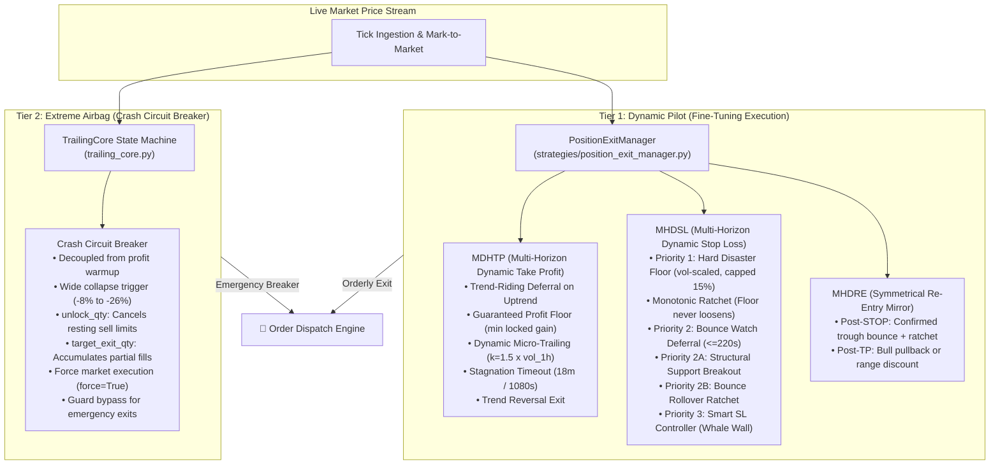

# FLEET PROTECTION MATRIX & ASSET RISK COVERAGE

**Date:** October 2026  
**Status:** VALIDATED, BENCHMARKED & INTEGRATED ON `main`  
**System:** `mptrade` (Unified Multi-Venue Autonomous Trading Fleet)

---

## 1. Two-Tier Protection Architecture

To ensure flawless capital preservation across high-volatility spot crypto, leveraged derivatives, and equity markets, the fleet enforces a strict **Two-Tier Defense Architecture**:

| Protection Tier | Responsibility & Scope | Algorithms & Modules | Execution Policy |
| :--- | :--- | :--- | :--- |
| **Tier 1: Dynamic Pilot (Fine-tuning)** | Manages intraday profit capture, stop deferral, and swing re-entries under normal trading regimes. | `MHDSL` (Multi-Horizon Dynamic Stop Loss) `MDHTP` (Multi-Horizon Dynamic Take Profit) `MHDRE` (Symmetrical Re-entry Mirror) Centralized in `PositionExitManager` | Evaluated on every tick/candle. Defers exit if trend is UP and bounce watch is active (`sl_bounce_state`). Allows profit to ride peak expansion (`tp_ride_state`) until volatility pullback triggers exit. Enforces 15% disaster cap and monotonic ratchet. |
| **Tier 2: Extreme Airbag (Extreme Protection)** | Last line of defense against flash-crashes, severe structural breakdown, and liquidity cascades. | `TrailingCore` (Binance & Kraken) `hard_disaster_floor_breached` (`PositionExitManager`) Trailing Crash Breaker (`212trading`) | **Completely decoupled from profit warmup:** fires unconditionally if disaster threshold is breached from peak/basis. Automatically cancels conflicting passive limit orders (`unlock_qty`), tracks partial fills via `target_exit_qty`, and forces instant market liquidation (`force=True`). |

---

## 2. Comprehensive Fleet Protection Matrix

| Venue | Symbol / Asset | Engine Role | Tier 1: Dynamic Protection (MHDSL / MDHTP / DCA) | Tier 2: Extreme Protection (Crash Circuit Breaker) | Operational Status & Rationale |
| :--- | :--- | :--- | :--- | :--- | :--- |
| **Binance** | `BTCUSDC` | Spot Swing / Grid | **MHDSL:** Loss threshold `2.925%`, bounce watch, dynamic ratchet, `hard_tp = 18.5%` (0.5 tranche, 6h cooldown). **MDHTP:** Active in `monitortrades.py` (Block 3.1). | **Trailing Stop:** `16%` from peak. **Decoupled from warmup.** **`unlock_qty`:** Automatically cancels passive sell orders on alert. | **ACTIVE.** Dual-layer protected swing and trend engine (Backtest winner applied). |
| **Binance** | `TAOUSDC` | Spot Swing / Grid | **MHDSL:** Loss threshold `5.25%`, bounce watch, dynamic ratchet, `hard_tp = 17%` (0.5 tranche). **MDHTP:** Active in `monitortrades.py`. | **Trailing Stop:** `22%` from peak. **Decoupled from warmup.** **`unlock_qty`:** Active. | **ACTIVE.** High-beta AI asset with tightened trailing crash breaker. |
| **Binance** | `ARBUSDC` | Spot Swing / Grid | **MHDSL:** Loss threshold `4.375%`, gain `9.0%`, bounce watch, dynamic ratchet, `hard_tp = 17%` (0.5 tranche). **MDHTP:** Active in `monitortrades.py`. | **Trailing Stop:** `26%` from peak. **Decoupled from warmup.** Automatic rebuy on 100-day moving average. **`unlock_qty`:** Active. | **ACTIVATED IN MONITORTRADES (`role.mt = yes`).** Dynamic swing cycles with wide safety net (Backtest winner applied, `mt.maxage_days = 17`). |
| **Kraken** | `HYPEUSD` | DCA Spot Engine | **MHDSL:** `STRAT_STOP_LOSS_PCT=25%` evaluated via `spot_engine.py` + `PositionExitManager`. **MDHTP:** Activated (`STRAT_TP_MDHTP_ENABLED=true`), trail `3%`, floor `1%`. **DCA Brake:** `STRAT_DCA_TREND_BRAKE=true`. | **Multi-Asset Trailing Stop:** `18%` in `kraken/trailing_stop.py`. **Market Liquidation:** `KRAKEN_TRAILING_MARKET=true` (60s check). **`unlock_qty`:** Cancels open orders on Kraken before exit. | **ACTIVE.** Dual-protected: DCA spot bot + independent trailing daemon with instant market exit. |
| **Kraken** | `TAOUSD` | DCA Spot Engine | **MHDSL:** Active via `PositionExitManager` (`STRAT_STOP_LOSS_PCT=25%`). **MDHTP:** Activated (`STRAT_TP_MDHTP_ENABLED=true`). **DCA Brake:** Active with spacing growth `+0.25pp`. | **Multi-Asset Trailing Stop:** `22%` in `kraken/trailing_stop.py`. **Market Liquidation:** Active. **`unlock_qty`:** Active. | **ACTIVE.** Multi-asset coverage defined in `trailing.conf`. |
| **Kraken** | `ADAUSD` | DCA Spot Engine | **MHDSL:** Active via `PositionExitManager` (`STRAT_STOP_LOSS_PCT=25%`). **MDHTP:** Activated (`STRAT_TP_MDHTP_ENABLED=true`). **DCA Brake:** Active. | **Multi-Asset Trailing Stop:** `25%` in `kraken/trailing_stop.py`. **Market Liquidation:** Active. **`unlock_qty`:** Active. | **ACTIVE.** Multi-asset coverage defined in `trailing.conf`. |
| **Hyperliquid** | `HYPEUSDC` (Spot) | DCA Long-Term | **MHDSL:** `STRAT_STOP_LOSS_PCT=25%`. On catastrophic break, `hard_disaster_floor_breached` (Priority 1) cuts position immediately. **MDHTP:** Activated (`STRAT_TP_MDHTP_ENABLED=true`), adaptive trail ($k=1.5$, clamp 1.5–6%). **DCA Brake:** `STRAT_DCA_TREND_BRAKE=true`, spacing growth `0.25pp`. | **Circuit Breaker:** `hard_disaster_floor_breached` (urgent market exit via `_request_market_exit` cancelling open orders). | **ACTIVE.** Downtrend DCA brake and emergency disaster stop active at 25%. |
| **Trading 212** | `SPCX_US_EQ` | Portfolio Stock | **MHDSL:** Active (`STRAT_SL_MHDSL_ENABLED=true`), disaster floor 30%, rebuy on 1.2% bounce. **MDHTP:** Active (`STRAT_TP_MDHTP_ENABLED=true`), dynamic 5-rung bell-curve ladder. | **Trailing Stop:** `8%` from peak with +5% profit warmup (locks in gains, does not cut ordinary accumulation dips). | **ACTIVE.** Scale-out ladder conflict eliminated; `tp_pending_exit` persistence. |
| **Trading 212** | `NVDA_US_EQ` | Portfolio Stock | **MHDSL:** Activated (`STRAT_SL_MHDSL_ENABLED=true`), disaster floor 30%, rebuy on 1.2% bounce. **MDHTP:** Activated (`STRAT_TP_MDHTP_ENABLED=true`). | **Trailing Stop:** `8%` from peak with +5% profit warmup (preserves 30% MHDSL tolerance during accumulation). | **ACTIVE.** Clean layer separation: profit trailing decoupled from cost-basis stop loss. |
| **Trading 212** | `RGNT_US_EQ` | High-Vol Biotech | **MHDSL:** Activated (`STRAT_SL_MHDSL_ENABLED=true`), disaster floor adapted to `50%` (standard DCA tier is at -40%). **MDHTP:** Activated (`STRAT_TP_MDHTP_ENABLED=true`), rides pumps over +35%. **Rebuy:** Active on 3.0% recovery bounce. | **Trailing Crash Breaker:** `20%` from peak with `20%` warmup (preserves -40% DCA dip buying and -50% MHDSL catastrophic floor). | **ACTIVE.** Specially calibrated for extreme volatility without premature whipsaw. |

---

## 3. Fleet-Wide Hardened Invariants & Safety Guarantees

1. **DCA Buy Suppression on Bounce Watch (`sl_bounce_state`):**
   * Across Kraken & Hyperliquid (`spot_engine.py`) and Trading 212 (`strategy.py`), while a position is in delayed stop bounce watch, placing new DCA buy orders is **strictly suppressed** to prevent capital dilution into unconfirmed breakdowns.
2. **Automatic Balance Unlocking (`unlock_qty`):**
   * Eliminates the risk of an emergency exit failing due to tokens/shares being locked inside resting limit Take-Profit orders. Adapters query open orders and cancel conflicting sells before executing market stops.
3. **Partial Exit Tracking (`target_exit_qty`):**
   * `TrailingCore` accumulates sold quantities and cost basis across partial fills, preserving peak protection and armed rebuy sizing until the entire target position is cleared.
4. **Composite Client Order Identity (`client_order_id`):**
   * Orders embed strategy and bot lineage (`inst.client_order_id`), allowing `monitororder` to safely reprice and track orders without identity collisions.
5. **Exit Intent Persistence (`pending_exit` / `tp_pending_exit`):**
   * If an exit order is rejected by an exchange due to transient transport timeout or API limits, the exit state is not reverted to HOLD. The exit intent persists in state and re-executes on subsequent ticks until fill confirmation.
6. **Emergency Floor Under Cost Basis:**
   * If market price collapses below cost basis during an active profit ride, an immediate emergency floor exit triggers, guaranteeing capital preservation.
7. **Monitortrades STOP Rollback Protection:**
   * If stop-loss placement fails or is rejected, active TP orders are restored safely without race conditions.
8. **Disaster Buffer Capping (15% Cap) & Monotonic Ratchet:**
   * `sl_disaster_buffer_max_pct = 0.15` caps volatility-induced buffer expansion, preventing runaway stop-loss degradation during extreme spikes. Once armed, the disaster floor operates monotonically and never loosens upward in loss.
9. **Single Source of Truth for Volatility Resolution:**
   * `intelligence.internal.state.volatility` standardizes ratio vs percentage conversions across all exit engines, preventing scaling mismatches.
10. **Dynamic Reload Triggering (`RELOAD_TRIGGER`):**
    * Any configuration update across `.env` files is registered by updating `RELOAD_TRIGGER` in `procs.conf`, signaling `python_orchestrator.service` to apply changes gracefully with zero manual intervention.
