# Architectural Analysis of Intelligence Pillars and LLM Usage in mptrade

**Date**: October 07, 2026  
**Status**: Official production documentation  
**Key components**: `intelligence/globaltelemetry_collector.py`, `intelligence/macro_analyzer.py`, `qlimit_order_guard.py`, `external_order_guard.py`, `llm_order_guard.py`, `order_guard.py`, `guard_hierarchy.py`, `intelligence/`

---

## 1. Intelligence Pillars Overview

The `mptrade` system uses a **4-Pillar Intelligence Architecture**, decoupled for ultra-low execution latency and multi-layered protection:

```mermaid
flowchart TD
    subgraph P1["Pillar 1: Internal Mathematical & Statistical Base (intelligence/internal/)"]
        direction TB
        M1["1D Kalman Filter (Trend & Velocity)"]
        M2["Gradient Inflection & Surge"]
        M3["Weibull Survival (Trend Exhaustion P90)"]
        M4["ParabolicSurgeGuard (Anti-FOMO)"]
        M5["NoiseFloorGuard & Volatility Regime"]
        note1["100% Local mathematics (0 ms, NO LLM)"]
    end

    subgraph P2["Pillar 2: External Microstructure & Flow (intelligence/external/)"]
        direction TB
        OB["L2 Orderbook Depth & Imbalance (15s)"]
        WALL["OrderbookWallGuard (Wall Detection)"]
        WHALE["Whale Positioning & Divergences (60s)"]
        DERIV["Funding Rates & Perp Open Interest (30s)"]
        note2["External telemetry feeds (0 ms execution, NO LLM)"]
    end

    subgraph P3["Pillar 3: Sentiment & LLM Reasoning (intelligence/sentiment/)"]
        direction TB
        FG["Fear & Greed Collector (API / TTL 1h)"]
        MB["Market Breadth 24h Advance/Decline"]
        HSG["HighStakeGuard<br/>(Event-driven: BUY/SELL >= 700 USD)"]
        ADV["SentimentAdvisor<br/>(Periodic 3h / cachedb)"]
        note3["Google Gemini LLM integrated"]
    end

    subgraph P4["Pillar 4: Macro Geopolitical Shield (intelligence/macro/)"]
        direction TB
        RSS["Google News RSS Feeds (every 120s)"]
        POOL["4h Rolling Pool (deduplicated)"]
        S1["Stage 1: Keyword Frequency Screening"]
        S2["Stage 2: Digest Check (Macro Shock)"]
        S3["Stage 3: Gemini Flash Reasoning (every 4.5 hours / 16200s)"]
        GEO_GUARD["GeopoliticalShockGuard (Veto / Downscale)"]
        note4["Google Gemini LLM integrated"]
    end

    P1 --> GUARD["order_guard.py (Bot execution / microsecond latency)"]
    P2 --> GUARD
    P3 --> GUARD
    P4 --> GUARD
```



---

## 2. Strict Differentiation: Pillar 1 vs. Pillar 3

### Pillar 1 - Pure Mathematical Base (`intelligence/internal/`)
- **Role**: Anti-FOMO protection and mathematical detection of price move exhaustion.
- **Technologies**:
  - Constant-velocity Kalman filters (`KalmanTrendTrigger`).
  - Empirical Weibull trend-survival time distributions (`WeibullExhaustionGuard`).
  - Parabolic price deviation calculation (`ParabolicSurgeGuard`).
  - Volatility and noise-floor estimation (`NoiseFloorGuard`).
- **Key property**: **Never invokes the LLM**. Runs 100% in local memory on every price tick with $0\text{ ms}$ latency.

### Pillar 3 - Sentiment & LLM Reasoning (`intelligence/sentiment/`)
- **Role**: Integrates market psychology and qualitative LLM reasoning.
- **Technologies**:
  - `FearGreedCollector`: Fear & Greed Index with contrarian action signals.
  - `MarketBreadthCollector`: 24h advance/decline across the Binance market.
  - `HighStakeGuard`: Real-time pre-trade risk vetting on large orders.
  - `SentimentAdvisor`: Qualitative macro/sentiment advisor.

---

## 3. Where and How the LLM Is Used (Google Gemini via `agy CLI`)

The LLM (`gemini-3.8-flash-low` via the local `agy` CLI) is invoked in the system **strictly in the following components**:

### A. Periodic Market Sentiment Advisor (`SentimentAdvisor`) - Pillar 3
- **Source file**: `intelligence/sentiment/sentiment_advisor.py`
- **Output**: `cachedb/sentiment_eval.json`
- **Evaluated inputs**:
  - Fear & Greed Index (value, label, 7-day delta).
  - 24h Market Breadth (% advancing coins, median change, breadth regime).
  - Whale and derivatives telemetry.
- **Generated synthesis**:
  - `market_bias`: `BULLISH` | `BEARISH` | `NEUTRAL` | `CAUTION`
  - `risk_level`: `LOW` | `MODERATE` | `HIGH` | `EXTREME`
  - `confidence`: $0.0 - 1.0$
  - `summary`: 1-2 sentence executive summary
  - `key_risks`: List of structural risks
  - `recommended_action`: `ACCUMULATE` | `HOLD` | `TRIM_PROFITS` | `DEFENSIVE`
- **Cadence and Trigger**:
  - **Cache TTL**: **3 hours** (`10800.0` seconds). When the cache is fresh, returns immediately without an external call.
  - **Trigger**: Periodically via `intelligence/macro_analyzer.py` or on-demand.
  - **Production note**: Decoupled from the hot trading path; writes passively to `cachedb/`.

### B. High-Stake Order Guard (`HighStakeGuard` / `GLLM1`) - Pillar 3
- **Source file**: `intelligence/sentiment/guards/high_stake_guard.py` (coordinated by `llm_order_guard.py`)
- **Integration**: Called directly in `order_guard.py` (`check_intelligence_guards`).
- **Cadence and Trigger**:
  - **Event-Driven (no fixed timer)**: Triggered strictly when a trading bot intends to submit an order.
  - **Activation conditions (Symmetric BUY & SELL)**:
    1. All local guards ($0\text{ ms}$: `G_QLIMIT2`, `GI_OBOOK`, `GI_WHALE`, `GI_FUNDING`) run symmetrically on **every** `BUY` and `SELL` order regardless of size.
    2. `GLLM1` (`HighStakeGuard`) activates symmetrically on `BUY` and `SELL` exclusively when notional value $\ge 700\text{ USD}$ (`high_stake_min_notional_usd = 700.0`). Orders below $700\text{ USD}$ or Stop-Loss exits do not invoke synchronous LLM checks.
    3. Notional cache protection: if an order context was recently evaluated at a similar notional level ($\pm 20\%$), the cached decision is reused without re-querying the LLM.
- **Possible decisions**: `allow`, `downscale` (on BUY), `defer_wait` (on SELL during an active short squeeze), `hard_veto` (full block).

### C. Macro Geopolitical Shield (`GeopoliticalThreatAnalyzer`) - Pillar 4
- **Source file**: `intelligence/macro/geopolitical_analyzer.py`
- **Output**: `cachedb/geopolitical_eval.json`
- **3-Stage Pipeline**:
  1. *Stage 1 (Regex Screening)*: Fast local keyword screening across RSS feeds collected every **120 seconds** into a rolling pool (`cachedb/news_feed_collect.json`).
  2. *Stage 2 (Digest Check)*: Threat frequency and density verification.
  3. *Stage 3 (LLM Reasoning)*: Invokes Gemini Flash for detailed geopolitical analysis of the aggregated news pool.
- **Cadence and Trigger**:
  - **Base periodic cadence in daemon**: **4.5 hours (16200 seconds)** (`MACRO_LLM_INTERVAL_SEC=16200`).
  - **Safety trigger**: When no major shocks appear in news feeds, Stage 3 runs at most once every 4.5-6.0 hours.
- **Impact on bots**:
  - `NORMAL`: No restrictions.
  - `ELEVATED`: Scales down new BUY orders by 50% (`DOWNSCALE_50`).
  - `CRITICAL_SHOCK`: Full veto on all new BUY orders (`HARD_VETO_NEW_BUYS`; sells/exits remain allowed).

---

## 4. CLI Project Configuration & Autonomous Housekeeping

- **Dedicated Antigravity Project**:
  - In `~/.gemini/config/projects/default-cli-project.json` and `autonommptrade.json`, the project name is set to **`autonommptrade`**.
  - All autonomous queries from `gemini_client.py` use `--project autonommptrade` in an isolated `agy-bot` store, separating automated history from manual sessions.
- **Automated Pruning**:
  - `orchestratorOS/admin/prune_llm_threads.py` runs automatically via cron and the daemon.
  - **Configured retention**: **1 day** (`CLI_THREAD_RETENTION_DAYS=1.0`).
  - Non-permanent automated threads older than 24h are pruned from SQLite and the filesystem, preventing unbounded disk and memory growth.

---

## 5. Configuration Parameter Matrix (`config.env` / `order_guard.conf`)

```ini
# Pillar 4: Geopolitical & LLM Evaluation
MACRO_LLM_INTERVAL_SEC=16200          # Base Stage 3 Gemini interval (16200s = 4.5 hours)
MACRO_NEWS_INTERVAL_SEC=120           # RSS collection and rolling pool cadence (120s = 2 min)

# Housekeeping & CLI
CLI_THREAD_RETENTION_DAYS=1.0         # Automated pruning of non-topic CLI threads > 1 day
AGY_PROJECT=autonommptrade            # Dedicated workspace for autonomous calls

# GLLM1: High-Stake Notional Guard (order_guard.conf) - Symmetric BUY & SELL
llm_guard_mode=enforce                # Execution mode: off | shadow | enforce
high_stake_min_notional_usd=700.0     # Unified notional threshold (USD) for GLLM1 activation (BUY & SELL)
llm_timeout_sec=120.0                 # Maximum timeout for LLM response
llm_fallback=allow                    # Fail-open safety policy on LLM timeout

# GT_S: Short Trend Guard (5m) - Mandatory across modules (cannot be disabled via bypass_guards)
# The 7-minute (420s) uptrend deferral timer lives in Trailing Stop (trailing.conf: sell_trend_defer_max_sec)
```
